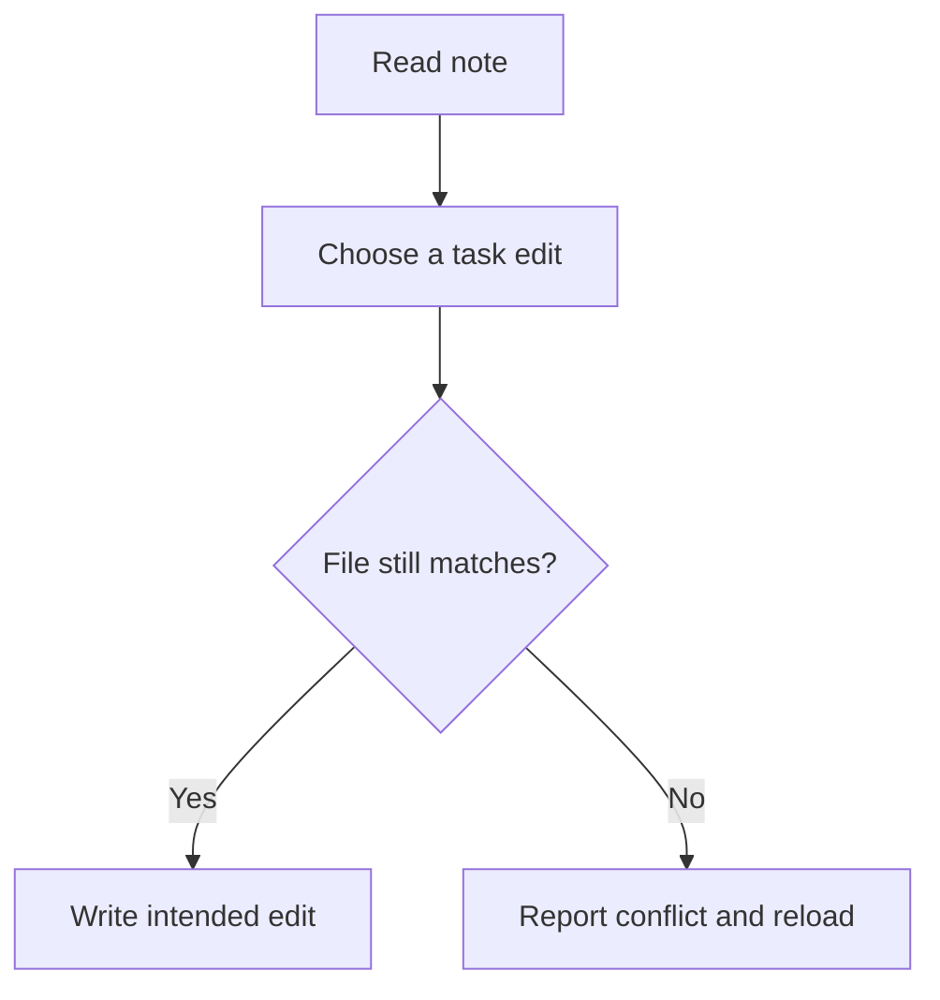

# What happens when a note changes before save?

[Project overview](README.md) · [Executable example](checklist_review.py)

## Follow the write

Ultron reads a Markdown file and presents its checklist in SwiftUI. Because the file remains editable outside the workspace, a checkbox interaction can be based on content that has since changed. The component compares the current file with the version it read. A detected change prompts a reload before the user can make a fresh edit.

## Reproduce the failure

The [public example](checklist_review.py) opens a temporary fixture, appends an external edit, and attempts a write from the earlier view. It checks that the write was refused and the file is intact. A fresh read then makes the intended change and checks the resulting bytes, including line endings. A duplicate-label case shows why a label alone can be an ambiguous way to identify a task.

The example accepts a deliberately small fixture format with flat task lines. The production case concerns the same save decision inside a broader application.

## The guarantee ends at the comparison

A snapshot comparison can detect an edit already visible on disk. Another writer can still change the file between comparison and write. Supporting concurrent writes would require a coordination mechanism understood by the writers, or a different persistence design. Reloading after a known conflict keeps that conflict visible and gives the user a current view from which to retry. [Publication scope](PUBLICATION.md)
