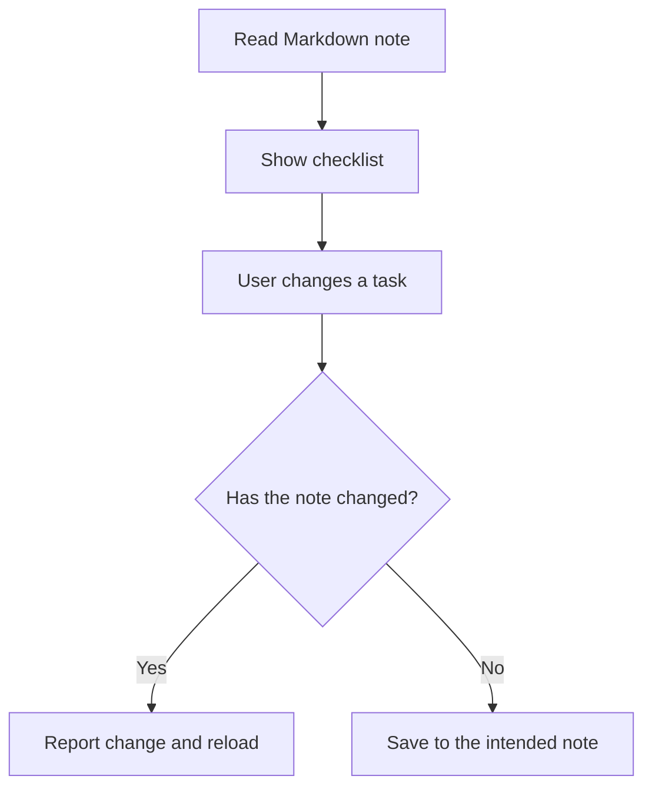

# Ultron

A native macOS workspace for reading local Markdown notes and working with checklist tasks.

[Read the case study](CASE_STUDY.md) · [Save behavior](#save-behavior) · [Publication scope](PUBLICATION.md)

## Keep the file useful

Ultron is built around a local Markdown vault. The underlying notes remain ordinary files, so the workspace needs to coexist with changes made outside the application.

The workflow component is a focused example of that problem. It reads a checklist, lets the user change a task, and checks whether the note changed before saving.

## Save behavior

The important behavior is the branch after the comparison. A stale view needs to be reconciled before it becomes a write to the file.

## Architecture

| Layer | Responsibility |
| --- | --- |
| Markdown records | Keep the notes readable outside the application |
| Parsing | Turn checklist content into display models |
| SwiftUI presentation | Show the note and available task interactions |
| Persistence | Write to the intended record and surface failures |

## Design decisions

**Respect external edits.** The application is not the only place where a Markdown note can change. Checking before a save makes that conflict visible.

**Keep the storage understandable.** Ordinary files make the underlying records accessible without requiring the interface to remain available.

**Report failures where they occur.** A failed read, a changed note, and a failed save are different situations. Treating them as the same empty screen would leave the user guessing.

The comparison is not a file lock. The [case study](CASE_STUDY.md) explains that limitation and the difference between a focused component and the full personal application.

## Scope and contribution

This publication documents the architecture and workflow behavior. Application code, vault contents, sample files, screenshots, connection settings, and development history remain private.

AI assisted with implementation, debugging, checks, and documentation. This editorial review does not establish that every live integration in the full application works. [Publication policy](PUBLICATION.md)
